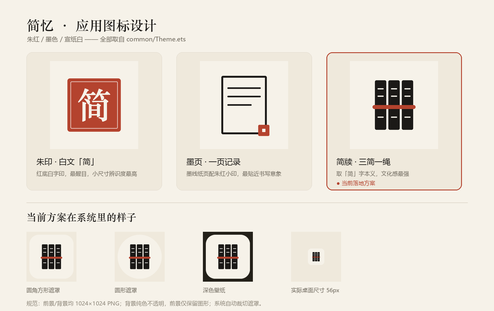

# 简忆 · jian-yi-harmony

一款鸿蒙原生的个人心智工具：记下值得记住的句子，安排今天要做的事，读完手里的书。

## 当前进度

| 模块 | 状态 | 说明 |
|---|---|---|
| 交互原型 | ✅ 完成 | 单文件 HTML，仅作设计参考，不是运行时 UI |
| 数据层 | ✅ 完成 | 7 张表 + 9 个仓库，已接入 `entry` 编译路径 |
| ArkUI 页面 | ✅ 完成 | 五个主视图 + 全局搜索 + 录入弹层 + 三个二级页 |
| 系统返回键 | ✅ 完成，真机已验证 | 搜索/二级页由系统页面栈逐层 pop；`Index.onBackPress` 管弹层、回今日、二次退出 Toast；11-13 手机确认逐层返回与退出提示 |
| 原生页面栈 | ✅ 完成，真机已验证 | `Index` / `SearchPage` / `SubPage` 三个 `@Entry` 页面，`UIContext.getRouter()` push/back |
| 迁移 Navigation | ⬜ 待做 | router 体系官方已不推荐，后续换 `NavPathStack` 以支持分栏与路由拦截 |
| 通知提醒 | 🟡 已实现，待真机验证 | 每晚 20:30 系统代理提醒 + 今日页开关 + 通知授权；真机前需 AGC 开通能力，见 `AGENTS.md` 3.4 |
| 应用图标 | ✅ 完成 | 纸墨风分层图标（简牍方案）+ 启动窗口图标，三方案可用脚本切换，见「应用图标」一节 |
| 电子书阅读 | 🟡 部分 | 书架与阅读进度已接库；正文解析待 Reader Kit |
| 云备份 | ⬜ 未开始 | `EntryBackupAbility` 骨架已有，导出逻辑待写 |

## 快速预览

直接用浏览器打开 [`jianyi-prototype.html`](./jianyi-prototype.html)，无需安装任何环境。
五个主页面（今日 / 待办 / 语录 / 阅读 / 计划）、全局搜索、四宫格快速记录都可以真实点击。
**这个 HTML 只是交互原型**；手机上跑的是 ArkUI 原生页面，不含 WebView。

**鸿蒙工程**用 DevEco Studio 5.0+ 打开本目录即可，`entry/src/main/ets/pages/Index.ets` 是入口页。
当前代码按 `compatibleSdkVersion 6.1.1(24)` 的 API 编写，2026-11-12 已在 DevEco Studio 修复编译问题并完成真机预览。
Agent 侧所在机器没有 HarmonyOS SDK，改动仍需 Studio 复验；给编码助手看的约定与踩坑记录见 [`AGENTS.md`](./AGENTS.md)。

## 目录结构

```
AGENTS.md                给 AI 编码助手看的速查、定位与踩坑记录
.trae/rules/             项目长期约定（与 AGENTS.md 冲突时以此为准）
jianyi-prototype.html    可交互原型（产品事实来源，仅设计参考）
design/                  应用图标生成器与预览（构建期脚本，不进 App）
  generate_icon.py       Pillow 生成两套分层图标 + startIcon
  icon-preview.png       三方案对比与各种遮罩 / 尺寸效果
  icon-full.png          当前方案的完整合成图
harmony-data/            ArkTS 参考实现（设计留档，不参与编译）
entry/src/main/ets/
  db/                     正式数据层（参与编译）
    Models.ets            7 张表的类型定义
    JianYiDb.ets          单例连接、建表迁移、UUID
    RowUtil.ets           ResultSet 取值助手
    EntryRepo.ets         语录 / 剪藏 / 手记、收藏、分类、搜索
    TodoRepo.ets          待办列表、勾选、统计（现算）
    ThoughtRepo.ets       待思
    HabitRepo.ets         习惯、打卡、连续天数（现算）
    MoodRepo.ets          心情
    BookRepo.ets          书籍与阅读进度
    EventRepo.ets         日程时间块
    SearchRepo.ets        全局搜索聚合
    Seed.ets              开发期示例数据
  common/
    Theme.ets             纸墨色板与尺寸常量
    DateUtil.ets          日期格式化
    Bus.ets               AppStorage 刷新总线 + UIContext 页面栈入口
    Reminder.ets          通知授权与后台代理提醒（每晚回顾）
  pages/                  三个 @Entry 页面：Index（栈底）/ SearchPage / SubPage
  view/                   五个主视图 + 搜索、录入弹层、二级页内容、共用小部件
  entryability/           EntryAbility（预热数据库）
```

`harmony-data/` 保留为设计参考；**实际编译运行的是 `entry/src/main/ets/db/`**。
两者内容大体一致，但正式版按项目规则把业务查询从 `JianYiDb.ets` 拆到了各自仓库，
并补齐了页面需要的搜索、统计、详情接口。

## 已实现的功能

- **待办**：今日 / 长期分段，新增、勾选、优先级、截止时间、逾期标记，统计数字查询时现算
- **语录**：分类筛选、收藏、记一句 / 剪藏 / 手记、详情页、软删除
- **全局搜索**：一次搜语录、待办、待思、书架，分组展示 + 命中高亮，点结果直接跳到对应页
- **今日页**：待办摘要、习惯点阵与连续天数、心情记录与七日柱、今日安排时间线
- **习惯 / 心情二级页**：打卡、连续天数、30 天热力图、心情周视图与最近记录
- **阅读 / 计划**：书架进度、周条切换、时间块与新增安排
- **快速记录**：悬浮按钮 → 四宫格 → 六种表单，全部真实写库
- **每晚回顾提醒**：今日页开关 → 通知授权 → 系统级每日 20:30 代理提醒，清后台也能到达（真机需先在 AGC 开通「代理提醒」并手动签名）

所有写入后通过 `AppStorage` 广播刷新，页面不互相持有引用，也不出现 SQL。

## 应用图标

当前落地的是「**简牍**」：宣纸白底上三片墨色竹简，一道朱红编绳横穿而过，简面留几笔米白字迹。取的是「简」字本义 —— 古人把字写在竹简上，正好对应「记下值得记住的东西」。三色全部取自 `common/Theme.ets`（`paper` / `ink` / `cinnabar`），和 App 内的纸墨界面同源；「三竖 + 一横」的强对比让它在圆形遮罩裁切后仍完整，缩到桌面 56px 也认得出。



另外两个备选方案是「朱印」（朱红方印 + 白文「简」）和「墨页」（墨线纸页 + 三道记录横线 + 朱红小印）。换方案只需重跑生成器，它会同步刷新 `AppScope` 和 `entry` 两套分层资源以及启动图标：

```bash
python design/generate_icon.py                  # slips 简牍（默认 / 当前落地）
python design/generate_icon.py --scheme seal   # seal  朱印
python design/generate_icon.py --scheme page   # page  墨页
```

资源按 HarmonyOS 分层图标规范导出：前景 / 背景均 1024×1024 PNG，背景纯色不透明、前景仅保留图形，系统自动加遮罩；`startIcon.png` 为 152×152。两处 `icon` 引用（`app.json5` 与 `module.json5`）都已指向 `layered_image`，**换图不需要改配置**，但两套目录必须同时更新，详见 `AGENTS.md` 3.5。

## 数据层

数据库为本地 RelationalStore（SQLite），文件 `databases/jianyi.db`。

三条贯穿全局的规则：

1. **主键用 UUID**，不用自增，为跨端同步留路
2. **软删除**，`deleted_at` 置时间戳，物理删除会让同步时记录复活
3. **派生数据不落库**，例如习惯连续天数、待办完成数，查询时现算

接入方式（`EntryAbility.onCreate` 预热，`Index.aboutToAppear` 等待完成）：

```typescript
import { initDb } from '../db/JianYiDb';

initDb(this.context).catch(() => { /* 记录日志 */ });
```

> 接口名请以你所用 SDK 版本的 `.d.ts` 为准。

**示例数据**：`db/Seed.ets` 在首次启动灌入一份与原型一致的示例，用来验证数据层与页面。
用 Preferences 打标记，用户删掉的数据不会被重启复活；正式发布把 `SEED_ENABLED` 置为 `false` 即可。

## 开发环境

**本地（推荐）**：DevEco Studio 5.0+，Windows 10/11 或 macOS 12.5+，内存 16GB 起。
仅开发和预览可不开模拟器，写完代码用云调试跑真机，能省下一大半内存。

**云端（试用）**：[鸿蒙开发实践中心](https://harmonybp.developer.huaweicloud.com/)
浏览器内编码、打包、调试，无需安装。但它是**案例制**——选择一个案例后自动加载该案例工程，
适合学习与验证流程，不保证能直接托管本仓库。

**云端（付费）**：华为云 Windows ECS + 远程桌面，在云主机里装 DevEco Studio。
DevEco Studio 不支持 Linux，纯 Linux 云主机走不通。

## 路线图

1. ✅ 环境就绪，跑通 Hello World
2. ✅ 待办页：列表 + 新增 + 勾选（验证数据层）
3. ✅ 语录页 + 全局搜索
4. ✅ 习惯、心情、待思
5. 🟡 通知提醒 —— 代码已接入 `reminderAgentManager` + 通知授权，待真机验证（需 AGC 开通代理提醒并手动签名）
6. ⬜ 电子书阅读 —— Reader Kit 正文解析，书架与进度已就绪
7. ⬜ 云备份与手动导出 —— `BackupExtensionAbility` 骨架已有

第 5–7 步都依赖真机 / 模拟器或特定 Kit；第 5 步代码已完成，效果留给用户真机调试时验证。

## 约定

编码规范、命名规则与协作约定见 [.trae/rules/project_rules.md](./.trae/rules/project_rules.md)。

色彩集中在 `common/Theme.ets`，与 `resources/*/element/color.json` 一一对应。
纸色主题不随系统深浅模式翻转，所以 dark 资源与 base 保持一致，避免启动窗口闪黑。
